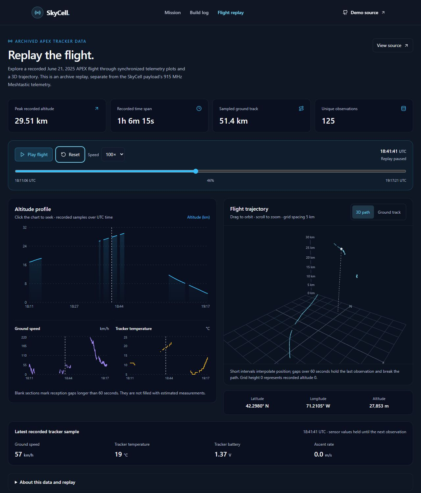

# SkyCell

**First place at Hack Club APEX 2025.**

SkyCell is a high-altitude balloon communications experiment built by **four students**. The mission reached **approximately 30 km altitude** and established a **70 km LoRa / Meshtastic radio link**. The project brought together Python flight software, radio hardware, ground-station logging, and a React / TypeScript flight explorer.

[Explore the demo](https://skycell.vercel.app/) · [Open flight replay](https://skycell.vercel.app/dashboard) · [Flight & ground-station source](https://github.com/knivier/SkyCell)

[](https://github.com/sharonbasovich/skycell/actions/workflows/ci.yml)



This repository contains the **React frontend**: the project showcase, engineering notes, and browser replay. The team's [companion repository](https://github.com/knivier/SkyCell) contains the payload, radio, and flight / ground-station software.

## Explore the flight

Play, pause, reset, or scrub the timeline at **1×, 25×, 100×, or 250× speed**. Follow the position in an interactive 3D trajectory or a north-up ground track while the telemetry charts and current readings follow the same replay clock. Browsers without WebGL 2 use the ground-track view.

The demo replays an archived APEX / SondeHub tracker recording. It runs without a radio receiver, API credentials, or a backend.

## Engineering

### 3D flight story

The `codex/skycell-scroll-flight` preview continues the integrated-flight checkpoint `f4e48e9`, making the flight itself the page. Eight continuous chapters move from the complete balloon and trailing payload into the same enclosure, a technical cutaway, the radio connection, the power lesson, the event recording and the final result. A coupled analytic wind/suspension model gives the envelope and payload distinct attitudes while keeping their tether taut. An additional bounded suspension response makes the payload lag the balloon's lateral screen travel when scrolling, settle afterward, and respond to reversed travel. Fixed world-space cloud volumes, the camera and the vehicle share coordinates, so flight creates perspective and occlusion instead of moving a cutout over a background. The footer has been removed; evidence and source links remain in the final chapter.

The camera approaches the payload to reveal interpreted sensing, compute, radio and power assemblies. That inspection explains the system; it does not depict the enclosure opening during flight. The recording chapter retains **125 actual fixes** and estimates positions and altitude between them by linear interpolation in time. Amber segments distinguish reception gaps longer than one minute. Scrolling moves the same balloon and payload along this complete partial-archive path, reveals travelled segments, updates UTC/altitude and pans the camera to expose depth; the showcase has no observation slider. Estimates stay inside the recorded interval, and the original CSV is unchanged. Original photographs, archive provenance and visual interpretation belong in the flight-notes dialog rather than permanent captions. Reduced motion and unavailable WebGL retain the eight chapters in normal reading order, optimized photographs and a static recording profile with previous/next-fix controls. The actual launch photograph still shows the event’s two balloons.

Original Blender sources remain in [`tools/asset-pipeline`](tools/asset-pipeline/README.md). NASA Blue Marble, historical MODIS imagery and a new Landsat/WELD terrain-detail patch have [documented provenance](docs/asset-credits.md). The native 30 m Landsat annual composite supplies local geographic detail rather than enlarging MODIS pixels; it is historical context, not flight-day imagery. Earth rendering follows the canvas density within bounded 2048/1024-pixel longest edges. Seven selected scene assets total **13,149,799 bytes desktop / 6,019,005 bytes compact**; two static fallback layers add **30,624 bytes**. Near clouds use a locally generated **32 KiB** density volume. Model, HDR and Earth-map loading are independent: a texture-free physical sky supports the live rig while maps arrive, imagery failures retain the live scene, and the live page never displays a poster balloon. One scroll spring and presented progress coordinate copy, camera and an adaptive pause/resume bridge; modal dialogs freeze ambient flight. Three verified heading comparisons are available through `?headings=1` (Lift), `?headings=2` (Depth), and `?headings=3` (Signal). Depth combines scroll entry with pointer response and is the recommendation; the base heading treatment remains unchanged pending Sharon's selection. **Lint, 71 tests, strict typecheck and the production build pass.** Recorded 26-second desktop/short-phone journeys, forward/reverse suspension and scroll-replay interactions passed with zero JavaScript/shader errors or failed requests. Final targeted checks at 1272×716, 415×582, 360×780 and 768×1024 confirm heading/control clearance after the last ending-timing and comparison-nav fixes. Intended imagery failures and a nine-second map delay retain the live scene. See [verification notes](docs/ascent-experience.md) for evidence and measurement limits, and the [integrated brief](docs/integrated-flight-brief.md) for scope. No deployment result is asserted here.

**Stack:** React · TypeScript · Vite · Tailwind CSS · React Three Fiber · Three.js · Recharts

```text
CSV archive → validated UTC observations → shared replay clock
                                                ├── 3D / ground trajectory
                                                ├── telemetry charts
                                                └── current readings
```

- **Validated ingestion:** a header-based CSV parser handles quoted fields and missing sensor values, validates timestamps and coordinates, sorts observations, and deduplicates timestamps. Single-payload validation prevents unrelated flights from becoming one track.
- **Timestamp-based playback:** a shared clock drives all views. Binary search selects the current observation; short intervals interpolate position, while reception gaps over 60 seconds hold the last position and break the plotted path.
- **Geographic visualization:** latitude, longitude, and altitude are projected into consistent spatial units for the Three.js trajectory. Orbit controls support rotation and zoom; an SVG ground track provides a fallback.
- **Responsive loading and failure handling:** the dashboard and 3D code load separately from the showcase. Failed archive requests and invalid data produce explicit retry states.

The **16 regression tests** cover CSV parsing, UTC offsets, duplicate observations, mixed payloads, reception gaps, HTTP failures, the bundled archive, and seeking during playback. GitHub Actions runs ESLint, Vitest, strict TypeScript checks, and the production build on pushes and pull requests.

## Archive provenance

The bundled [`public/data.csv`](public/data.csv) contains **125 APEX-2-T observations from June 21, 2025**, exported from the APEX tracker / SondeHub data. It spans **18:11:06–19:17:21 UTC** and records a peak altitude of **29,510 m**.

This tracker archive uses **Horus Binary v2 around 432.625 MHz** and is separate from SkyCell's **915 MHz mesh payload telemetry**. The browser demo displays a partial flight recording rather than a live radio feed. Sensor values remain the latest received readings; interpolated positions are estimates between nearby observations. See [data documentation](docs/data.md) for the schema, source, and replay semantics.

## Run locally

Use **Node.js 24** (the CI version) or Node.js 22.12+ and npm.

```bash
git clone https://github.com/sharonbasovich/skycell.git
cd skycell
npm ci
npm run dev
```

Open [http://localhost:8080](http://localhost:8080).

| Command              | Purpose                                               |
| -------------------- | ----------------------------------------------------- |
| `npm run typecheck`  | Check application and configuration types             |
| `npm run lint`       | Run ESLint                                            |
| `npm test`           | Run the regression tests                              |
| `npm run test:watch` | Re-run tests while developing                         |
| `npm run build`      | Type-check and build the production bundle in `dist/` |
| `npm run preview`    | Preview the production bundle locally                 |

## Deployment

The [live demo](https://skycell.vercel.app/) runs on Vercel. [`vercel.json`](vercel.json) configures `npm ci`, the checked production build, and direct navigation to `/dashboard` and `/development`. Import this repository into Vercel to deploy another instance; no environment variables are required.
